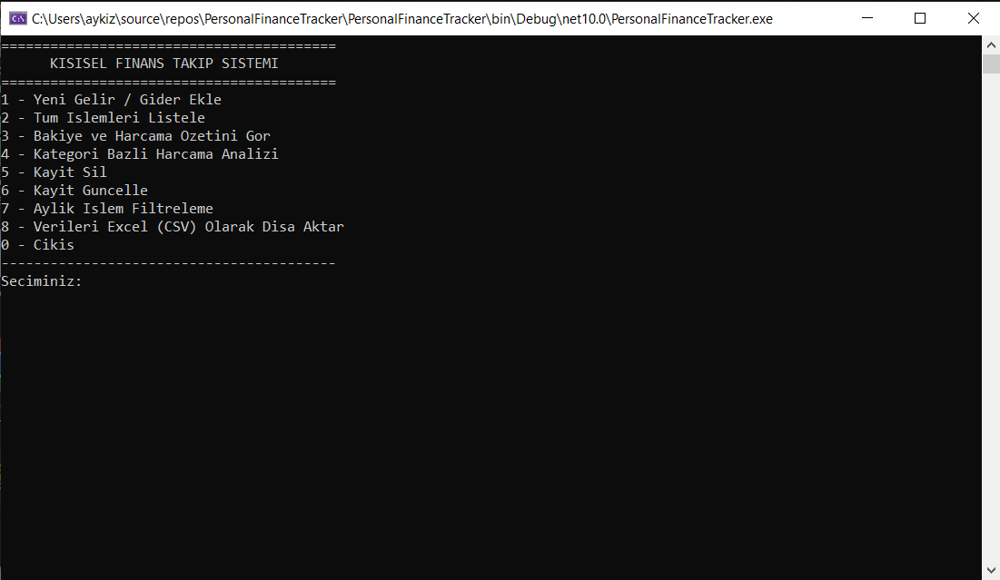
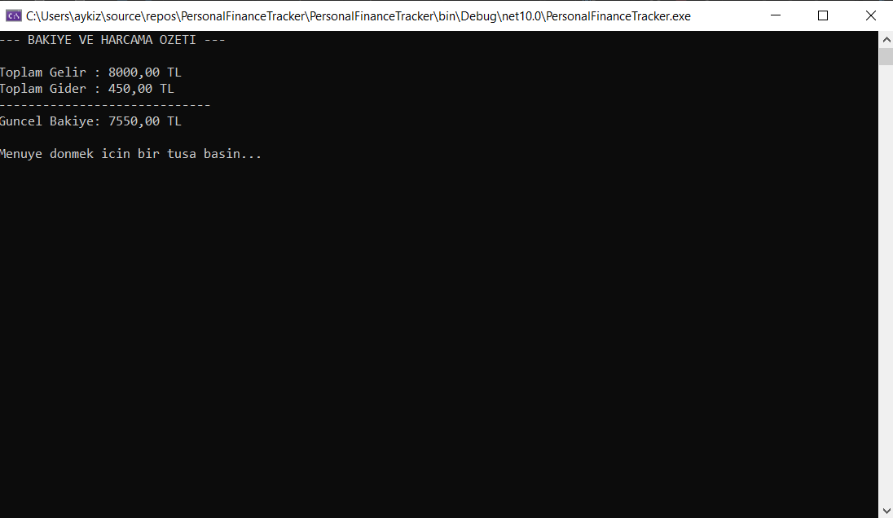
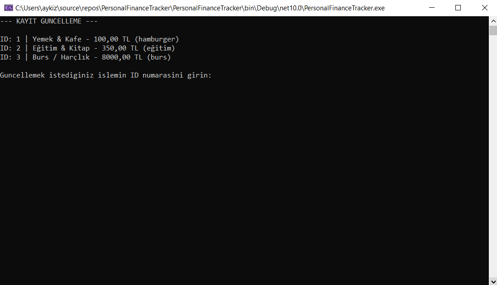
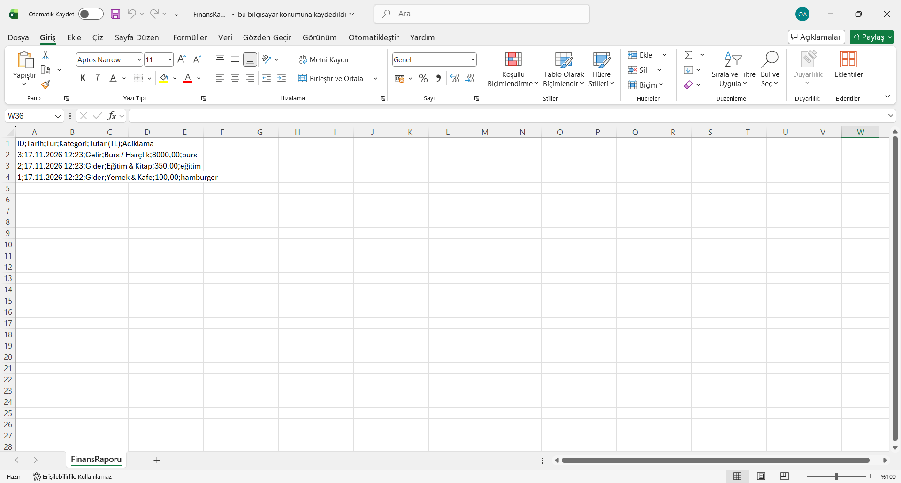

# Personal Finance Tracker

C# ve Microsoft SQL Server kullanarak geliştirdiğim konsol tabanlı kişisel gelir-gider takip uygulaması. Öğrendiğim C#, SQL ve Git/GitHub bilgilerini tek bir projede birleştirip pratiğe dökmek amacıyla hazırladım.

## Özellikler
* Yeni gelir ve gider kaydı ekleme
* Tüm işlemleri tarih sırasına göre listeleme
* Toplam gelir, gider ve güncel bakiye özetini görüntüleme
* Kategori bazlı harcama analizi (`GROUP BY`)
* İşlem numarasına (ID) göre kayıt silme ve güncelleme
* Ay ve yıl bazında geçmiş işlemleri filtreleme
* Kayıtları Excel (`.csv`) formatında masaüstüne dışa aktarma

## Kullanılan Teknolojiler
* C# (.NET Console Application)
* Microsoft SQL Server (MSSQL)
* Microsoft.Data.SqlClient (ADO.NET)
* System.IO (`StreamWriter` ile CSV dosya oluşturma)
* Git & GitHub

## Ekran Görüntüleri

| Ana Menü | Bakiye ve Harcama Özeti |
| :---: | :---: |
|  |  |

| Kayıt Güncelleme | Excel (CSV) Rapor Çıktısı |
| :---: | :---: |
|  |  |

## Kurulum ve Çalıştırma
1. SQL Server üzerinde `PersonalFinanceDB` adında bir veritabanı oluşturun ve proje klasöründeki `database.sql` dosyasını çalıştırarak `Users`, `Categories`, `Transactions` tablolarını kurun.
2. `Program.cs` içerisindeki `baglantiAdresi` değişkenini kendi SQL Server sunucu adınıza göre güncelleyin.
3. Projeyi Visual Studio üzerinden derleyip çalıştırın.